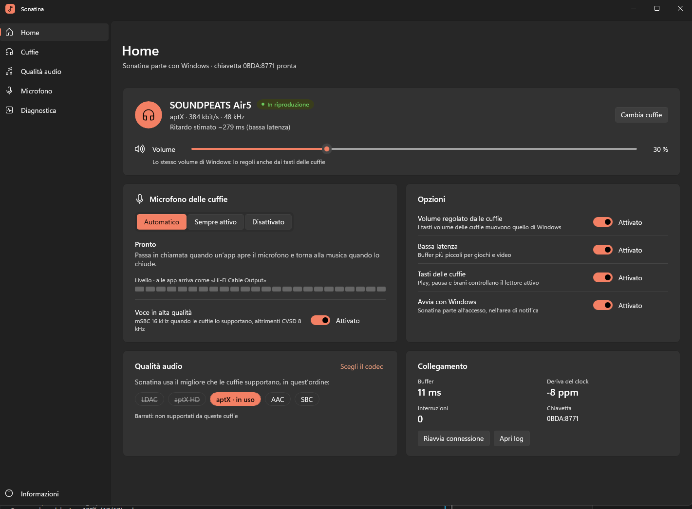

# Sonatina

[](https://github.com/zChronoX/Sonatina/actions/workflows/host.yml)


Sonatina streams the sound of Windows to Bluetooth headphones in **LDAC** (up to 990 kbit/s),
**aptX HD**, **aptX**, **AAC** or **SBC**, through a **dedicated USB Bluetooth adapter**, without any kernel driver of its own.
Secure Boot stays on, so anti-cheat software (Riot Vanguard, ...) keeps working.

<p align="center"></p>

```
Windows apps ──► VB-CABLE (virtual output) ──► Sonatina ──► LDAC / aptX / AAC / SBC ──► USB adapter (WinUSB) ──► headphones
```

- Works with any A2DP headphones: the best codec they support, in this order: LDAC, aptX HD, aptX,
  AAC, SBC.
- Several headphones: pair them once, Sonatina uses whichever one you switch on.
- Follows the Windows volume and mute; headphone buttons control the player.
- The headphone **microphone** works in Windows apps (Discord, Teams...): when an app opens it,
  Sonatina switches the headphones to call mode by itself and back to music afterwards.
- Runs in the notification area and starts with Windows; a Windows 11 style window shows the
  headphones, codec, microphone and link, and holds all the settings.

## Requirements

- Windows 10 (2004) or 11, 64-bit.
- A **USB Bluetooth adapter dedicated to Sonatina**. Windows will not use it any more, so keep the
  built-in Bluetooth (or a second adapter) for mice, keyboards and other devices.

  | Adapter | Chip | USB ID | Status |
  |---|---|---|---|
  | Generic "Bluetooth 5.0" Realtek dongles | RTL8761BUV | `0BDA:8771`, `0BDA:A728` | tested |
  | UGREEN BT 6.0 | Barrot | `33FA:0012` | not yet (needs a fix) |

  Other Realtek RTL8761B/C dongles should work too (the firmware is included).
- For the microphone (optional): **Hi-Fi Cable** from vb-audio.com/Cable (free,
  `HiFiCableAsioBridgeSetup`). Set **Hi-Fi Cable Output** as the default microphone; keep
  **CABLE Input** as the default output. VB-CABLE A+B (paid) or the Steam microphone work too.

## Install

1. Plug in the adapter you want to dedicate to Sonatina.
2. Download `SonatinaSetup-<version>.exe` from the
   [Releases](../../releases) page (or from the latest *Sonatina host* workflow run) and run it.
3. In the installer:
   - choose the adapter (the one marked *used by Windows* will be taken over by Sonatina);
   - leave **Download and install VB-CABLE** ticked if asked: in the VB-CABLE window click
     **Install Driver**. Restart Windows when the installer asks.
4. Put your headphones in **pairing mode**. On its first start Sonatina searches for them by itself;
   then right-click the tray icon → **Headphones** → **Pair: <name>**.

Sonatina makes VB-CABLE ("CABLE Input") the default Windows output the first time it runs. You can
rename it (Settings → System → Sound → CABLE Input → Rename), for example to "Headphones".

## Using it

Click the tray icon (or start Sonatina again from the Start menu) to open the **Sonatina window**:

| Section | What it shows / does |
|---|---|
| Home | headphones, state, codec and estimated delay, volume, microphone mode and level, options, codec chain, link health |
| Headphones | paired headphones (use these / forget), pair new ones |
| Audio quality | preferred codec per headphones (unsupported ones greyed out), LDAC quality, low latency |
| Microphone | Automatic / Always on / Off, HD voice, level, voice codec, lost frames, apps using it |
| Diagnostics | buffer, clock drift, dropouts, packets; restart connection, open the log, copy the full status |
| About | version, start with Windows, log file, open source components |

Closing the window does not stop Sonatina: music keeps playing from the tray. The window follows
the Windows language (English or Italian) and light/dark theme.

The icon in the notification area shows the state: **blue** streaming, **green** call mode
(microphone live), **grey** waiting for the headphones, **red** adapter missing or error. Hover it to see the headphones, codec and volume.

Right-click menu:

| Menu | What it does |
|---|---|
| Headphones | switch between paired headphones, search and pair new ones, forget the current ones |
| Audio quality | LDAC 990 / 660 / 330 kbit/s, aptX HD, aptX, AAC or SBC, remembered per headphones |
| Volume handled by the headphones | the Windows volume moves the headphones' own volume and their volume buttons move the Windows slider (AVRCP absolute volume, when supported) |
| Headphone microphone | **Automatic** (call mode while an app uses the microphone), **Always on**, **Off**; HD voice (mSBC) |
| Low latency (games, video) | smaller buffers and packets; the tooltip shows the estimated delay to your ears |
| Headphone buttons | play/pause, next and previous control the current player (Spotify, browsers, Media Player...) |
| Open Sonatina | opens the window (also a left click on the icon) |
| Restart connection | reconnects the headphones |
| Open log | `%LOCALAPPDATA%\Sonatina\sonatina.log` |
| Exit | stops Sonatina until the next sign-in |

The menu follows the Windows display language (English or Italian). Settings live in `%LOCALAPPDATA%\Sonatina\settings.json`;
pairing keys in `%LOCALAPPDATA%\Google\bumble\Pairing`.

## Uninstall

Settings → Apps → **Sonatina** → Uninstall. The adapter is given back to Windows (its WinUSB
driver package and certificate are removed). VB-CABLE stays installed: remove it from Apps if you
no longer need it, and pick your normal output in the sound settings.

## Troubleshooting

- **No sound**: the Windows output must be "CABLE Input"; the tray icon must be blue.
- **Red icon**: the adapter is unplugged or another program owns it. Re-plug it, then *Restart
  connection*. The installer log is `C:\Program Files\Sonatina\install.log`.
- **Headphones do not connect**: switch them off and on; if needed *Forget* them and pair again.
- **Video ahead of the sound**: Bluetooth headphones add their own buffer (often 150-250 ms;
  many have a game mode that cuts it). Turn on *Low latency*, prefer aptX or SBC, and if your
  player has an audio delay setting (VLC, mpv) use the delay shown in the tooltip.
- **Choppy sound at LDAC 990**: choose LDAC 660 or 330 (weak radio link) in *Audio quality*.
- **Pops after installing Hi-Fi Cable**: update to 0.5.0 or later (older versions captured the
  wrong cable). The Windows output must stay "CABLE Input"; Sonatina puts it back by itself.
- **Microphone silent in an app**: the app must use "Hi-Fi Cable Output"; the tray icon turns
  green while the app holds the microphone. The Windows sound settings page does not count.
- **Odd sound for a few seconds after the PC wakes up** (noise, too slow then too fast): Windows
  and the player resynchronise their audio after sleep; Sonatina reconnects the headphones by
  itself and the sound settles within about 15 s.
- **The window says "Sonatina is not running"**: press *Start Sonatina*; the window connects by
  itself. Window problems are logged in `%LOCALAPPDATA%\Sonatina\dashboard.log`.
- Attach `sonatina.log` when reporting a problem.

## Limits (for now)

- In call mode the headphones only get phone-quality sound (Bluetooth HFP): HD voice
  (mSBC 16 kHz) when the headphones support it, CVSD 8 kHz otherwise. That is a limit of
  Bluetooth calls, the same on phones.
- No aptX Adaptive / Lossless (no open encoder). AAC is limited by the headphones' packet size
  (about 220 kbit/s on the CMF, 256 on most).
- Audio is ~200–300 ms late (Bluetooth + buffers); Windows does not know it, so video lip-sync can
  be off.

## Building

- Tests run on every push: `.github/workflows/host.yml` (Bumble virtual controllers, no hardware).
- The window (`sonatina/dashboard`, C# / WinUI 3) is compiled on every push (job *dashboard*).
  Locally, with the free .NET 8 SDK: `sonatina\dashboard\build.ps1 -Run`.
- The installer is built by the same workflow on `v*` tags or by a manual run
  (*Actions → Sonatina host → Run workflow*): PyInstaller (`Sonatina.exe`), the window,
  libwdi `wdi-simple`, Realtek firmware, Inno Setup (`sonatina/installer/sonatina.iss`).
- Development run without installing: `sonatina/host/README.md`.

## How it works

`sonatina/host/sonatina_host.py` captures "CABLE Output" (WASAPI), keeps a small jitter buffer,
applies the Windows volume, encodes with `sonatina_codec.dll` (libldac and libsbc in C) on a
monotonic media clock and sends RTP over AVDTP/L2CAP with [Bumble](https://github.com/google/bumble),
a user-mode Bluetooth host that drives the adapter through WinUSB.

For the microphone, `sonatina_hfp.py` keeps a Hands-Free (HFP Audio Gateway) connection next to
A2DP; when an app opens the virtual microphone it suspends A2DP, opens an eSCO link over the
adapter's isochronous USB endpoints and moves voice both ways (CVSD or mSBC, resampled in
`sonatina_codec.dll`). Notes on the USB details are at the top of that file.

The window is a separate program (`SonatinaDashboard.exe`, .NET 8 + Windows App SDK, self-contained)
that talks to the tray through `sonatina_ipc.py`: a local TCP channel on 127.0.0.1 with a random
token in `%LOCALAPPDATA%\Sonatina\ipc.json`, newline-delimited JSON, live status pushed 4 times
a second.

## Repository layout

| Path | What |
|---|---|
| `sonatina/host` | the app: host, tray, AVRCP, HFP, codec DLL (`codec/`), tests (`tests/`), tools |
| `sonatina/dashboard` | the Sonatina window (C#, WinUI 3) |
| `docs/images` | screenshots for this page |
| `sonatina/installer` | Inno Setup script and the adapter setup helper |
| `.github/workflows/host.yml` | tests and window build on every push, installer on `v*` tags |
| `archive/` | earlier kernel driver, pure-Python prototype and notes, kept as reference (see `archive/README.md`) |

## Licences

Sonatina code: MIT, see `LICENSE`. Third-party parts: Bumble (Apache-2.0), libusb (LGPL-2.1), libldac and
libsbc from AOSP (Apache-2.0), Fraunhofer FDK AAC (FDK AAC licence, see
`sonatina/host/codec/third_party/fdk-aac/NOTICE`; it grants no patent licence), libfreeaptx
(LGPL-2.1+), libwdi `wdi-simple` (LGPL-3.0), Realtek firmware (linux-firmware,
redistributable), PyInstaller bootloader (GPL with exception), .NET and Windows App SDK (MIT). VB-CABLE and Hi-Fi Cable
come from vb-audio.com and are not part of this project. "Bluetooth", "LDAC", "aptX" and "AAC" are trademarks of their owners.
